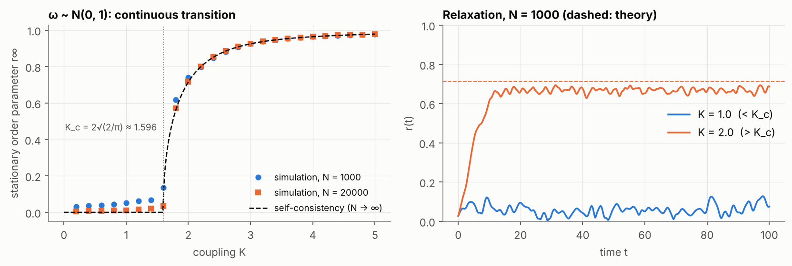
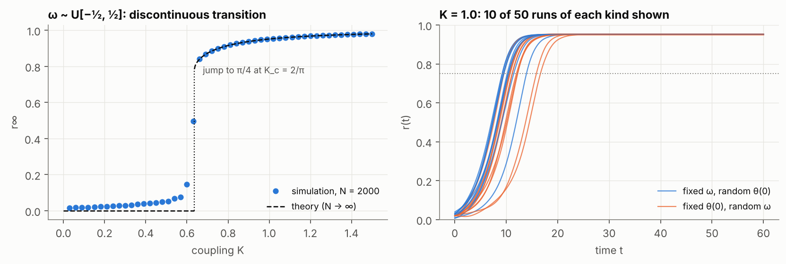

# Synchronisation in the Kuramoto model

Code: [`src/complexsys/kuramoto.py`](../src/complexsys/kuramoto.py) ·
Script: [`scripts/kuramoto_sync.py`](../scripts/kuramoto_sync.py) ·
Numbers: [`results/kuramoto.json`](../results/kuramoto.json)

## Model

There are N oscillators with phases θ_i and natural frequencies ω_i drawn from
a density g(ω), each coupled to all the others:

  dθ_i/dt = ω_i + (K/N) Σ_j sin(θ_j − θ_i) = ω_i + K r sin(ψ − θ_i),

where r e^{iψ} = (1/N) Σ_j e^{iθ_j}. The order parameter r ∈ [0, 1] measures
coherence: r ≈ 0 when the phases are scattered, r = 1 when they coincide. The
second form shows that each oscillator feels the others only through the mean
field. Each evaluation of the right-hand side therefore costs O(N) rather than
O(N²).

For N → ∞ and a symmetric unimodal g, the stationary partially locked state
satisfies the self-consistency condition

  1 = K ∫_{−π/2}^{π/2} cos²x · g(K r sin x) dx,

which has a solution r > 0 only above Kuramoto's threshold K_c = 2/(π g(0)).

## Numerical method

The equations are integrated with fourth-order Runge–Kutta at dt = 0.05.
Halving the step moves the stationary r by about 10⁻⁵; the test suite checks
that the change stays below 10⁻⁴. All values of K are integrated in a single vectorised array, so
a full sweep costs about as much as one run in a loop. The stationary value r∞
is the time average of r(t) over the final quarter of each run, not the single
value r(T), which at finite N fluctuates by several hundredths.

The theoretical curves come from solving the self-consistency equation with a
bracketing root-finder on (0, 1]. The original code used Newton's method
started at r = 1, which can converge to negative roots that must then be
clipped by hand.

## Gaussian frequencies: a continuous transition

With ω ~ N(0, 1), K_c = 2√(2/π) ≈ 1.596. Above threshold the simulations
follow the self-consistency curve: at K = 3, r∞ = 0.925 at both N = 1,000 and
N = 20,000, against a theoretical 0.925. Below threshold r∞ should be zero. It
is not, because N phases scattered at random have |r| of order 1/√N: r∞ ≈ 0.05
at N = 1,000 and 0.01 at N = 20,000. The rounding of the transition near K_c
is the same finite-size effect.

On the right, at K = 1 < K_c, the order parameter fluctuates around this
finite-N noise floor. At K = 2 it rises within about ten time units to a
plateau near the theoretical 0.715. This particular frequency sample settles
slightly lower, around 0.67. A sample of 1,000 frequencies does not reproduce
g(0) exactly, and the stationary r is sensitive to g(0) close to threshold.

## Uniform frequencies: a discontinuous transition

For ω ~ U[−γ, γ], the integral can be done in closed form. Writing sin a = γ/(Kr),

  1 = (K / 2γ) · (a + sin a cos a).

The threshold is K_c = 4γ/π, which equals 2/π ≈ 0.637 for γ = ½. Unlike the
Gaussian case, r does not grow continuously from zero. At K_c every oscillator
locks at once, and r jumps from 0 to π/4 ≈ 0.785 (Pazó, 2005), because a flat
density has no centre that locks first. The simulation with N = 2,000 shows
this jump, rounded by finite size. Above K_c it agrees with the theory to
within 0.003: at K = 0.72, r∞ = 0.886 against 0.885.

### What sets the relaxation time?

At K = 1 (stationary r = 0.952), 50 runs were made with fixed frequencies and
fresh initial phases, and 50 with fixed initial phases and fresh frequencies.
The relaxation time τ is the first time r(t) reaches 0.75.

|  | mean τ | standard deviation |
|---|---|---|
| fixed ω, random θ(0) | 11.2 | 1.8 |
| fixed θ(0), random ω | 12.0 | 2.4 |

The original study, with ten runs of each kind, concluded that the model is
more sensitive to the frequencies than to the initial phases. With fifty runs
the evidence for that is weak. Levene's test finds no difference in spread
(p = 0.60). A Welch test on the means gives p = 0.07: suggestive, but not
significant at the 5 % level.

> **Corrections to the original code.** (1) A run that never reached the
> threshold was recorded with τ = 0 and averaged in as an instantaneous
> relaxation; it is now recorded as missing. (2) The order parameter at t = 0
> was never computed, so every r(t) curve began at zero. (3) The double Python
> loop over oscillators is replaced by array operations.
