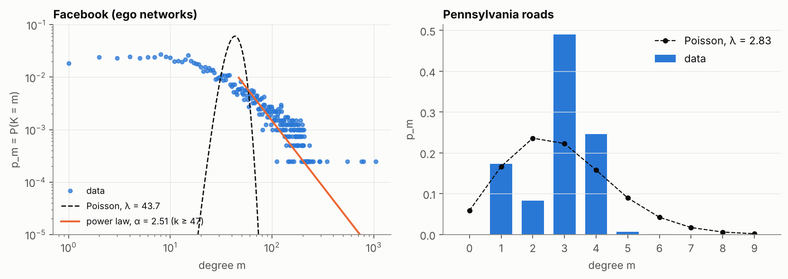
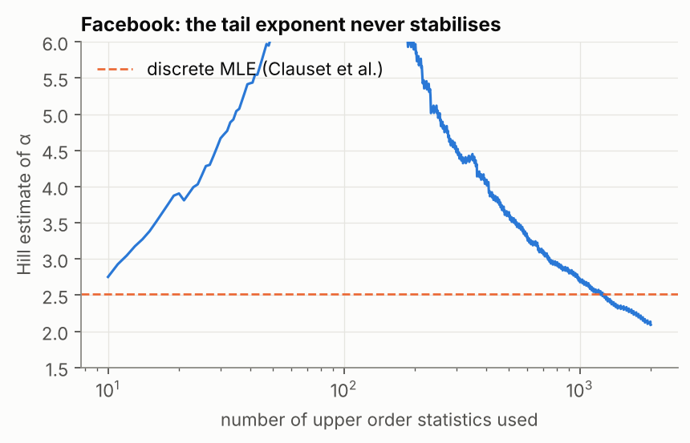
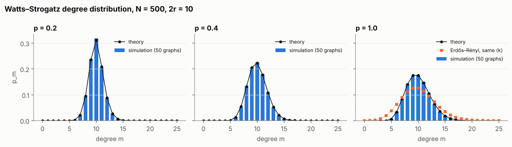
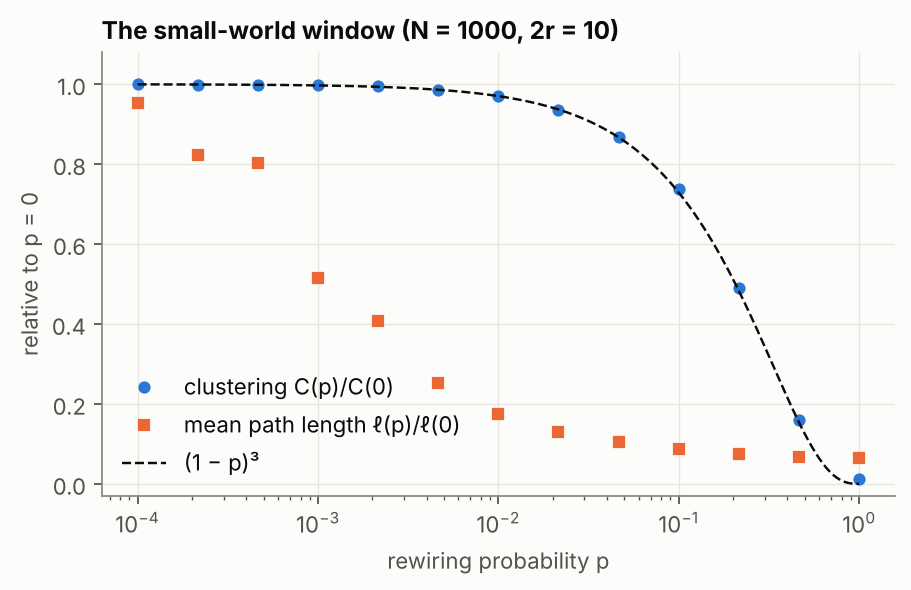

# Real and small-world networks

Code: [`src/complexsys/networks.py`](../src/complexsys/networks.py) ·
Script: [`scripts/networks_study.py`](../scripts/networks_study.py) ·
Numbers: [`results/networks.json`](../results/networks.json)

## 1. Two real networks

Two undirected networks from SNAP were chosen to contrast: a social network,
the usual example of a heavy-tailed degree distribution, and a road network,
where geography limits the number of roads that can meet at a junction.

|  | Facebook (ego networks) | Pennsylvania roads |
|---|---|---|
| nodes | 4,039 | 1,088,092 |
| edges | 88,234 | 1,541,898 |
| mean degree ⟨k⟩ | 43.7 | 2.83 |
| maximum degree | 1,045 | 9 |
| average clustering C | 0.6055 | 0.0465 |

Both clustering coefficients agree with the values SNAP publishes (0.6055 and
0.0465). The road figure differed slightly in the original version of this
study. The cause was a bug: the code took the number of nodes as the largest
node identifier plus one, which adds 2,828 phantom isolated nodes to the road
network. The loader now relabels the nodes that actually occur.

Clustering is computed from the sparse identity C_i = (A³)_ii / (k_i(k_i − 1)),
using only the entries of A² on existing edges. No dense N × N matrix is
formed, so the million-node road network takes under a second.

### The friendship paradox

Pick a node uniformly at random, then one of its neighbours uniformly at
random. On average the neighbour has more neighbours than the node:
E[k_neighbour] ≥ E[k]. Averaging over edges rather than nodes gives the
size-biased mean ⟨k²⟩/⟨k⟩. The original study estimated the effect from 100
sampled nodes; it is now computed exactly over every node.

|  | Facebook | Roads |
|---|---|---|
| mean degree ⟨k⟩ | 43.7 | 2.83 |
| mean degree of a random neighbour | 105.6 | 3.18 |
| size-biased mean ⟨k²⟩/⟨k⟩ | 106.6 | 3.20 |
| nodes whose neighbours average more friends than they have | 87.5 % | 48.2 % |

On Facebook the paradox is extreme: the typical person's friends have, on
average, two and a half times as many friends as the network average. On the
road network the effect exists but is small, because degrees barely vary.

### Is either network scale-free?

**Poisson hypothesis.** The maximum-likelihood estimate is λ = ⟨k⟩. The
Pearson χ² test rejects the Poisson model for both networks (p < 10⁻¹⁶). The
original analysis ran the χ² test over hundreds of degree classes with
expected counts near zero, where the χ² approximation does not hold. Classes
are now pooled until each expects at least five observations. The conclusion
is unchanged, but the test is now valid.

**Power-law hypothesis.** The tail is fitted with the discrete maximum-likelihood
estimator of Clauset, Shalizi & Newman (2009). The lower cutoff k_min minimises
the Kolmogorov–Smirnov distance. Goodness of fit is assessed by their
semi-parametric bootstrap: 500 synthetic data sets, each refitted from scratch,
including k_min.

|  | α̂ | k_min | tail size | KS distance | bootstrap p |
|---|---|---|---|---|---|
| Facebook | 2.51 | 47 | 1,250 | 0.101 | < 0.002 |
| Roads | 5.37 | 3 | 809,035 | 0.097 | < 0.002 |

Both are rejected. For the road network this was expected. For Facebook it
contradicts the heuristic choice the original study started from. The
estimated exponent 2.51 lies in the range (2, 3) often quoted for social
networks, yet the data are not power-law distributed: the distribution is flat
for small degrees and bends continuously. A plausible log–log slope is not
evidence of a power law.

The Hill estimator gives a second view, again following Voitalov et al.,
*Scale-free networks well done* (2019). If the tail were a power law, the
estimate would settle on a plateau as more order statistics are used. Instead
it drifts from above 6 down to 2.1. One caveat: this data set is a union of ten
ego networks, a sampling design that by itself distorts the degree
distribution. A single crawl of a social network could behave differently.

## 2. The Watts–Strogatz model

A graph WS(N, 2r, p) starts as a ring where every node is linked to its r
nearest neighbours on each side. Each clockwise edge is then rewired, with
probability p, to a node chosen uniformly at random.

### Degree distribution

Each node keeps r of its original edges for certain. Its other r original
edges survive independently with probability 1 − p, and rewired edges land on
it approximately as a Poisson(rp) count. This gives

  p_m = Σ_{n=0}^{min(m−r, r)} C(r, n) (1 − p)ⁿ p^{r−n} (rp)^{m−r−n} e^{−rp} / (m − r − n)!,  m ≥ r,

and p_m = 0 for m < r.

For N = 500 and r = 5, the formula matches 50 simulated graphs to within 0.007
in every degree class. At p = 1 it reduces to a Poisson distribution of K − r,
which is visibly narrower than an Erdős–Rényi graph with the same mean degree:
every node keeps at least r edges.

> **Correction.** The original implementation summed over n < min(m − r, r)
> instead of n ≤ min(m − r, r), dropping the last term of every sum. At p = 0.2
> the resulting "distribution" summed to 0.43 instead of 1, and p₁₀ came out as
> 0.19 instead of 0.31. A test now checks that the formula is normalised and
> agrees with simulation.

### The small-world window

Rewiring a fraction p ≈ 0.01 of the edges shortens the mean path length by a
factor of about six, while clustering remains at 97 % of its lattice value.
Clustering follows C(p) ≈ C(0)(1 − p)³, with C(0) = (3r − 3)/(4r − 2) = 2/3 for
r = 5: a triangle survives only if all three of its edges escape rewiring.
Path lengths are computed on connected realisations
(`networkx.connected_watts_strogatz_graph`).
