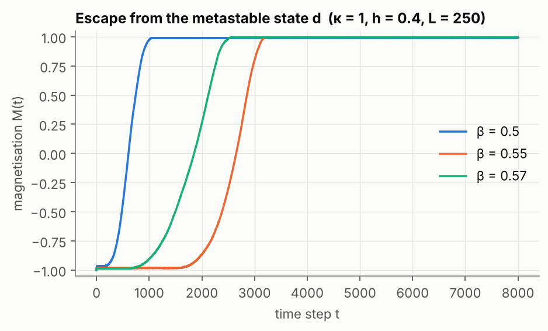
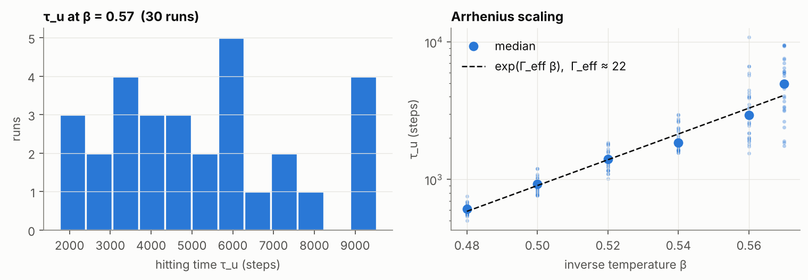
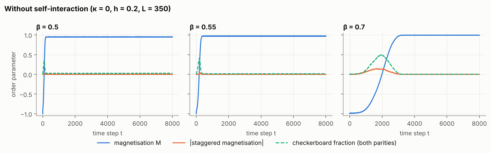
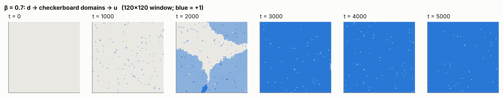

# Metastability in a probabilistic cellular automaton

Code: [`src/complexsys/pca.py`](../src/complexsys/pca.py) ·
Script: [`scripts/pca_nucleation.py`](../scripts/pca_nucleation.py) ·
Numbers: [`results/pca.json`](../results/pca.json)

## Model

Spins σ(x) = ±1 sit on an L × L torus. At each time step *every* spin is
resampled simultaneously and independently, with

  P[σ_{t+1}(x) = +1 | σ_t] = ½ [1 + tanh β(κ σ_t(x) + S_t(x) + h)],

where S_t(x) is the sum of the four nearest neighbours, β the inverse
temperature, h > 0 an external field and κ ≥ 0 a self-interaction. This is a
parallel cousin of the Ising heat-bath dynamics. It is reversible with respect
to the Gibbs-like measure μ(σ) ∝ exp(−H(σ)), where

  H(σ) = −βh Σ_x σ(x) − Σ_x log cosh β(κσ(x) + S(x) + h).

For 0 < h < 1, the configuration u (all +1) is the unique ground state. The
system is started from d (all −1). Because the field favours +1, d is not
stable, but at low temperature it is *metastable*: escape requires a rare
fluctuation that creates a droplet of +1 large enough to grow. Which route the
system takes depends on κ.

## Verification

The test suite checks the implementation against facts that can be
established exactly:

* **Reversibility.** Detailed balance p(σ, η) μ(σ) = p(η, σ) μ(η) holds to
  relative precision 10⁻¹⁰ for random pairs among all 512 configurations of a
  3 × 3 torus.
* **Ground states.** Exhaustive enumeration of all 65,536 configurations of a
  4 × 4 torus confirms that u is the unique minimiser of the zero-temperature
  energy E(σ) = −hΣσ − Σ|κσ + S + h| for h ∈ (0, 1). For h = κ = 0 it finds
  four minimisers: u, d and the two checkerboards.
* **Update rule.** One step from d produces +1 spins with the frequency the
  formula predicts.

## Implementation

The original code updated the lattice with Python lists and `map`, one site at
a time. Since S(x) ∈ {−4, −2, 0, 2, 4} and σ(x) = ±1, the update probability
takes only ten values. The rewrite precomputes them in a lookup table, computes
neighbour sums with array shifts, and evolves many independent replicas as one
three-dimensional array. A step of the 350 × 350 lattice now takes 2.7 ms
instead of 0.48 s, about 180 times faster. An 8,000-step run takes 21 seconds
instead of an hour, which is what makes the hitting-time statistics below
affordable.

## With self-interaction (κ = 1): escape from d

With L = 250 and h = 0.4, the system lingers near d until a supercritical
droplet appears, then switches to u within about a thousand steps. In these
single runs the escape at β = 0.57 happens *before* the one at β = 0.55. A
single trajectory says little about the escape time, which is a random
variable with a broad distribution.

### Hitting times

The hitting time τ_u is the first step at which the magnetisation reaches 0.85.
For each β there are 30 independent runs, each allowed up to 60,000 steps.

| β | 0.48 | 0.50 | 0.52 | 0.54 | 0.56 | 0.57 |
|---|---|---|---|---|---|---|
| mean τ_u | 608 | 926 | 1,403 | 2,032 | 3,531 | 5,198 |
| standard error | 10 | 21 | 42 | 81 | 366 | 429 |
| median τ_u | 608 | 931 | 1,403 | 1,848 | 2,931 | 4,987 |

As β increases, the times grow roughly exponentially and their spread widens:
nucleation becomes a rarer event. A least-squares fit of log(median τ_u)
against β gives τ_u ∝ exp(Γ_eff β) with Γ_eff ≈ 22.

This is an *effective* barrier and should be read with two caveats.
Metastability theory predicts E[τ] ≍ exp(βΓ) only as β → ∞, whereas these
temperatures are moderate. And on a 250 × 250 lattice many droplets can
nucleate in parallel, so τ_u combines nucleation and growth and depends on the
system size. Reaching the asymptotic regime would require larger β and longer
runs, and checking whether Γ_eff converges.

> **Correction.** The original estimate of E[τ_u] at β = 0.57 capped each run
> at 8,000 steps and recorded runs that had not escaped as τ = 0. In the present
> sample, 4 of 30 runs take longer than 8,000 steps. Counting them as zero
> lowers the estimated mean from 5,198 to 3,939, an error of 24 %. Runs that do
> not hit are now marked as censored and never averaged as zeros, and the cap is
> long enough that none are censored.

## Without self-interaction (κ = 0): the checkerboard phase

With κ = 0 a site ignores its own spin. A site whose four neighbours all
disagree with it therefore sees the field −4σ(x) + h, and flips. As a result,
the two checkerboards c_e and c_o map into each other at every step: they form
a **stable pair** (c_e, c_o), not a fixed point. This shows clearly in the
data: once a checkerboard region forms, the staggered magnetisation
M_stag = L⁻² Σ(−1)^{x₁+x₂} σ(x) changes sign at every step. The original plots
of signed M_stag therefore showed a solid band. The figure plots |M_stag|.

|M_stag| underestimates how much of the lattice is checkerboard, because
domains of opposite parity cancel. A parity-blind order parameter does better:
the **checkerboard fraction**, the share of sites whose four neighbours all
disagree with them.

At β = 0.5 and 0.55 the system goes almost directly to u, with only a brief
flicker of checkerboard order. At β = 0.7 it follows the route the theory
predicts: d → checkerboard → u. The checkerboard spreads from the initial
state, covers a large part of the lattice, and is then invaded by droplets of
u, as the snapshots show.

Over 30 runs at β = 0.7 (L = 350, h = 0.2, 8,000 steps):

| quantity | value |
|---|---|
| peak checkerboard fraction, median (range) | 0.59 (0.38 to 0.97) |
| runs in which the checkerboard covers more than half the lattice | 21 of 30 |
| time of the checkerboard peak, mean ± standard error | 2,318 ± 74 steps |
| hitting time of u (M ≥ 0.85), mean ± standard error | 3,271 ± 118 steps |

Every run passes through the checkerboard phase, but how much of the lattice it
conquers varies widely. The size of the peak depends on whether u nucleates
before the checkerboard domains merge.

> **Correction.** The original code timed the checkerboard by waiting for
> |M_stag| ≥ 0.97, and recorded τ = 0 for any run that never got there. That
> threshold requires a single parity to cover at least 98.5 % of the lattice,
> which forces the checkerboard fraction above 0.925. Only 2 of the 30 runs
> come that close. The original estimate of E[τ_c] was therefore dominated by
> spurious zeros. The time of peak coverage measures the same transition
> without this bias.

## References

* E. N. M. Cirillo, F. R. Nardi, *Metastability for a stochastic dynamics with a parallel heat bath updating rule*, J. Stat. Phys. (2003). [doi:10.1023/A:1021070712382](https://doi.org/10.1023/A:1021070712382)
* E. N. M. Cirillo, F. R. Nardi, C. Spitoni, *Metastability for reversible probabilistic cellular automata with self-interaction*, J. Stat. Phys. (2008). [doi:10.1007/s10955-008-9563-6](https://doi.org/10.1007/s10955-008-9563-6)
